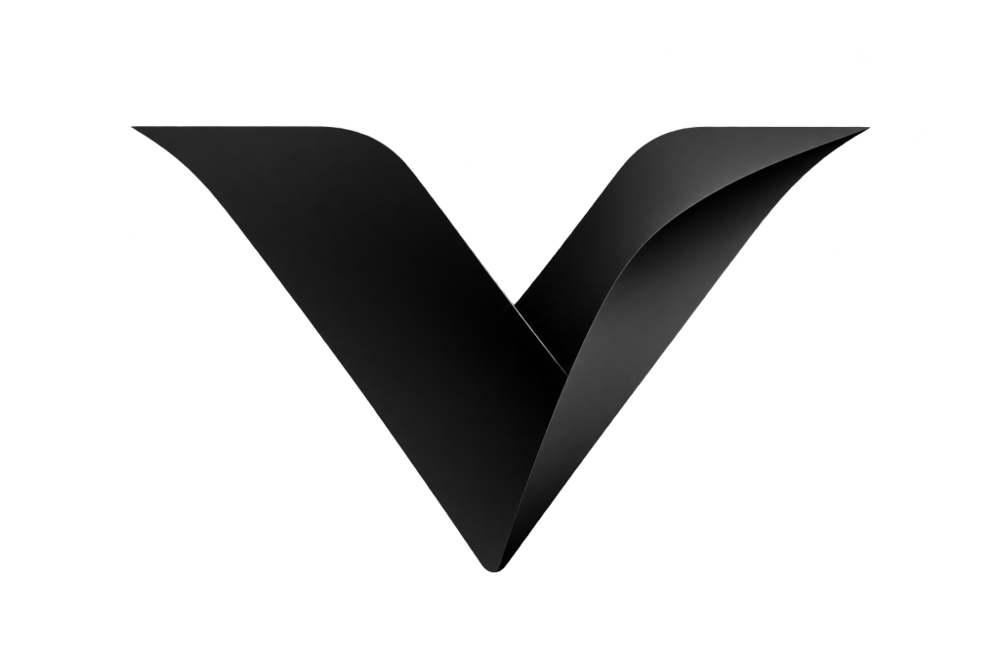

<p align="center">
  <a href="https://visionhq.tech">
    
  </a>
</p>

<h1 align="center">Vision</h1>

<p align="center">
  <strong>The Open-Source AI Business Observability Platform</strong><br>
  Unifying Product Analytics, Session Replay, LLM Token Costs, and Unit Economics in One Platform.
</p>

<p align="center">
  <a href="https://github.com/abhirupkumar/vision-oss/blob/main/LICENSE"></a>
  <a href="https://docs.visionhq.tech"></a>
  <a href="https://docker.com"></a>
  <a href="https://clickhouse.com"></a>
  <a href="https://tinybird.co"></a>
  <a href="https://github.com/abhirupkumar/vision-oss/stargazers"></a>
</p>

<p align="center">
  <a href="https://visionhq.tech">Website</a> •
  <a href="https://docs.visionhq.tech">Documentation</a> •
  <a href="https://docs.visionhq.tech/self-hosted">Self-Hosting Guide</a> •
  <a href="https://docs.visionhq.tech/guides">Guides</a> •
  <a href="https://docs.visionhq.tech/api">API Reference</a>
</p>

---

## ⚡ What is Vision?

**Vision** is a next-generation, developer-first observability and analytics platform engineered specifically for modern AI products, SaaS, and web applications.

Traditional analytics platforms force you to stitch together 4 different tools:
- A product analytics tool (Mixpanel, PostHog)
- A session replay tool (FullStory, LogRocket)
- An APM / error tracker (Datadog, Sentry)
- An LLM observability tool (LangSmith, Helicone)

**Vision unifies all four layers into a single, cohesive engine:**
1. **Web & Product Analytics**: Real-time traffic, pageviews, custom events, UTM attribution, geographic breakdown, device insights, and conversion funnels.
2. **Visual Session Replays**: High-fidelity DOM session recordings with privacy masking, rage-click detection, console log captures, and error correlation.
3. **LLM Observability**: End-to-end tracing for OpenAI, Anthropic, Gemini, DeepSeek, and custom models. Track latency, prompt/completion tokens, model errors, and token burn rates.
4. **Unit Economics & Margin Tracking**: Automatically connect LLM inference spend to customer revenue to understand true gross margin per user, tier, and session.

---

## 🥊 Why Vision? How Is It Better?

| Feature / Dimension | **Vision (Open-Source)** | **PostHog** | **Mixpanel** | **Datadog** | **LangSmith** |
| :--- | :---: | :---: | :---: | :---: | :---: |
| **All-in-One Engine** (Product + Replays + LLM) | ✅ **Native** | ⚠️ Replays only (no native LLM cost attribution) | ❌ Analytics only | ❌ Complex APM, expensive | ❌ LLM traces only |
| **LLM Token & Cost Attribution** | ✅ **Native** | ❌ | ❌ | ⚠️ Cloud APM plugin | ✅ |
| **Live Unit Economics (Margin/User)** | ✅ **Native** | ❌ | ❌ | ❌ | ❌ |
| **Self-Hosting Complexity** | ⚡ **1 Command** (`docker compose up`) | ⚠️ Heavy (requires ClickHouse, Kafka, Redis, temporal) | ❌ Closed-source | ❌ Closed-source SaaS | ❌ Closed-source SaaS |
| **Storage Architecture** | 🚀 **ClickHouse or Tinybird** | ClickHouse only | Proprietary | Proprietary | Proprietary |
| **Client Tracker Overhead** | 🪶 **< 3KB** lightweight script | ~45KB bundle | ~30KB bundle | ~70KB bundle | Server only |
| **License** | 🆓 **GNU AGPLv3** | BSL / PostHog proprietary | Closed | Closed | Closed |

---

## 🚀 60-Second Self-Hosting Quickstart

Run a full, production-ready Vision Community Edition cluster with a single Docker Compose command:

### 1. Clone the repository
```bash
git clone https://github.com/abhirupkumar/vision-oss.git vision
cd vision
```

### 2. Configure Environment
Copy the pre-configured open-source environment template:
```bash
cp docker/.env.oss.example .env
```

### 3. Launch the Cluster
```bash
docker compose up -d
```

### 4. Open the Dashboard
Navigate to [http://localhost:3000](http://localhost:3000) in your browser:
- Register your admin account.
- Create your first project.
- Grab your project tracking snippet and start ingesting data!

> [!TIP]
> **Zero Database Setup Needed**: The ClickHouse container automatically bootstraps all 18 tables, materialized views, and sorting keys from `docker/clickhouse-init.sql` on first boot.
> For advanced production deployment configurations, read the full [Self-Hosting Guide](https://docs.visionhq.tech/self-hosted).

---

## 📦 Client SDKs & Integration

### 1. Browser (HTML / React / Next.js)

Add the lightweight tracker directly to your website's `<head>`:

```html
<script
  defer
  data-project="YOUR_PROJECT_ID"
  data-api="http://localhost:3001"
  data-replay="true"
  src="https://unpkg.com/@vision/browser@latest/dist/tracker.min.js">
</script>
```

Or install via npm/pnpm:
```bash
pnpm add @vision/browser
```

```typescript
import { initVision, trackEvent } from "@vision/browser";

// Initialize tracker
initVision({
  projectId: "YOUR_PROJECT_ID",
  apiUrl: "https://api.yourdomain.com",
  sessionReplay: true,
  maskAllInputs: true,
});

// Track custom business conversions
trackEvent("upgrade_clicked", {
  plan: "enterprise",
  billingInterval: "yearly",
});
```

---

### 2. Python & LLM Observability

Install the Vision Python SDK:
```bash
pip install vision-core
```

Trace LLM calls and automatically track token spend and user margins:
```python
from vision import Vision
from openai import OpenAI

vision = Vision(project_id="YOUR_PROJECT_ID", api_url="https://api.yourdomain.com")
client = OpenAI()

# Wrap completion with automatic token tracking
with vision.trace(user_id="user_123", feature="chat_copilot") as trace:
    response = client.chat.completions.create(
        model="gpt-4o",
        messages=[{"role": "user", "content": "Explain unit economics"}],
    )
    trace.record(response)
```

---

## 🏛️ System Architecture

Vision is architected as an ultra-high performance Turborepo monorepo:

```
vision/
├── apps/
│   ├── dashboard/       # Full-stack Next.js 15 UI, Replay player, and charts
│   ├── backend/         # High-throughput Hono ingestion & analytics API
│   ├── ingestion-worker/# Optional streaming consumer micro-batching into ClickHouse
│   ├── docs/            # Fumadocs documentation portal (docs.visionhq.tech)
│   └── public/          # Landing marketing site (visionhq.tech)
├── packages/
│   ├── db/              # Drizzle ORM (Postgres) + ClickHouse & Tinybird drivers
│   ├── tracker/         # <3KB browser tracking client with session recording
│   └── ui/              # Shared Tailwind CSS design system components
└── docker/
    ├── docker-compose.oss.yml # 1-command community deployment stack
    └── clickhouse-init.sql    # Zero-config ClickHouse schema initialization
```

### Storage Engine Flexibility
- **ClickHouse (Default Self-Hosted)**: Run pure open-source analytics with zero cloud dependencies.
- **Tinybird (Serverless ClickHouse)**: Seamlessly switch storage by setting `TINYBIRD_URL` and `TINYBIRD_TOKEN`. No code changes required.

---

## 📚 Documentation & Resources

Dive into our comprehensive documentation at **[docs.visionhq.tech](https://docs.visionhq.tech)**:

- 📖 **[Getting Started Quickstart](https://docs.visionhq.tech/quickstart)**
- 🐳 **[Self-Hosting Guide](https://docs.visionhq.tech/self-hosted)**
- ⚡ **[ClickHouse Setup & Tuning](https://docs.visionhq.tech/self-hosted/clickhouse)**
- 🐦 **[Tinybird Integration Guide](https://docs.visionhq.tech/self-hosted/tinybird)**
- 🌊 **[High-Throughput Kafka Streaming](https://docs.visionhq.tech/self-hosted/kafka-streaming)**
- 💡 **[Guides & How-Tos](https://docs.visionhq.tech/guides)**
  - [Build Conversion Funnels](https://docs.visionhq.tech/guides/build-a-funnel)
  - [Identify Logged-In Users](https://docs.visionhq.tech/guides/identify-logged-in-users)
  - [Send Server-Side Events](https://docs.visionhq.tech/guides/send-server-side-events)
  - [Measure Campaigns & UTMs](https://docs.visionhq.tech/guides/measure-campaigns)
- 🔌 **[REST API Reference](https://docs.visionhq.tech/api)**

---

## 🤝 Contributing

We welcome community contributions! Whether it's reporting a bug, improving documentation, submitting an SDK integration, or proposing a feature:

1. Fork the repository
2. Create your branch (`git checkout -b feature/amazing-feature`)
3. Commit your changes (`git commit -m 'feat: add amazing feature'`)
4. Push to your branch (`git push origin feature/amazing-feature`)
5. Open a Pull Request

Please review our [Contributing Guidelines](https://docs.visionhq.tech/contributing) and [Code of Conduct](https://docs.visionhq.tech/code-of-conduct).

---

## 📄 License

Vision Community Edition is open-source software licensed under the **[GNU Affero General Public License v3.0 (GNU AGPLv3)](LICENSE)**.
