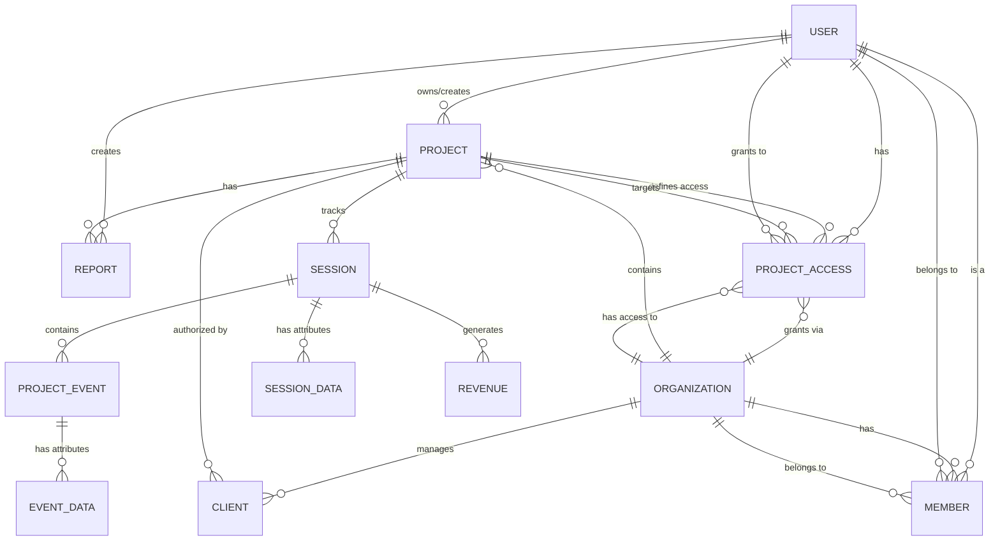

# Vision Analytics Schema Documentation

This document provides a detailed overview of the database schema for the Vision Analytics platform. The architecture is designed for multi-tenancy, high-performance analytics tracking, and flexible access control.

## Entity-Relationship Diagram

The following diagram illustrates the core entities and their relationships.

## Core Schema Components

### 1. Identity and Hierarchy
*   **User**: The fundamental identity. Users can own projects directly or be part of an organization.
    *   *Linked via*: `user_id`.
*   **Organization**: A container for teams and shared projects. Supports multi-tenant isolation.
    *   *Linked via*: `organization_id`.
*   **Member**: A junction table that connects Users to Organizations with specific roles (e.g., admin, member).

### 2. Workspace and Access
*   **Project**: The primary unit of analytics. Every tracked website or application is a "Project".
    *   *Owner*: Can be a `User` or an `Organization`.
    *   *Linked via*: `project_id`.
*   **ProjectAccess**: A granular permission system allowing specific users or organizations to access projects with different `AccessLevel` (read, write, admin).
*   **Client**: API credentials (API Keys) used to send data to specific projects or organizations.

### 3. Analytics Tracking (The Data Engine)
*   **Session**: Represents a unique visitor's journey. It captures metadata like browser, OS, device, and location (country/city).
    *   *Linked to*: `Project` via `project_id`.
*   **ProjectEvent**: Individual actions taken by a user (page views, button clicks).
    *   *Linked to*: `Session` via `session_id`.
*   **EventData & SessionData**: Flexible key-value stores for custom properties. 
    *   *EventData*: Attributes specific to one action (e.g., "cart_value" on a "purchase" event).
    *   *SessionData*: Attributes that persist across the session (e.g., "user_plan").

### 4. Insights and Extensions
*   **Report**: Saved analytical views created by users for specific projects.
*   **Segment**: Filtered subsets of data (e.g., "Power Users" or "Mobile Traffic").
*   **Revenue**: Financial tracking linked to specific events and sessions.
*   **Link & Pixel**: Marketing tools for tracking external traffic and conversion pixels.

---

## Key Linking Attributes (Foreign Keys)

| From Table | To Table | Attribute | Purpose |
| :--- | :--- | :--- | :--- |
| `Member` | `User` | `user_id` | Identifies which user is in the org. |
| `Project` | `Organization` | `organization_id` | Links a project to its parent org. |
| `Session` | `Project` | `project_id` | Associates traffic with a website. |
| `ProjectEvent` | `Session` | `session_id` | Groups events into a single visit. |
| `EventData` | `ProjectEvent` | `project_event_id` | Attaches metadata to a specific action. |
| `ProjectAccess` | `Project` | `project_id` | Grants permission to a specific project. |

> [!TIP]
> The schema uses `relationMode = "prisma"`, meaning relationships are managed at the application level rather than hard foreign keys in the database. This allows for better compatibility across different database providers (like PlanetScale or Vitess).
