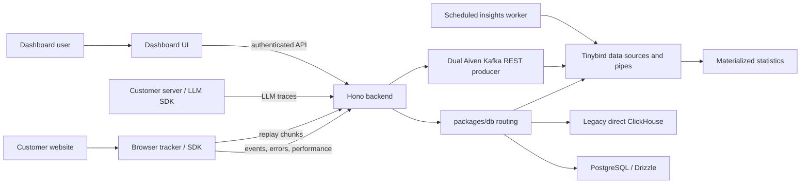

# System Architecture

## Product Shape

Vision is a pnpm/Turborepo monorepo for a privacy-focused analytics product. It combines:

- A dashboard web application for project administration and analytics exploration.
- A Hono backend that serves collection APIs and authenticated product APIs.
- A shared database package that owns schemas, analytics drivers, routing, and query implementations.
- Browser and LLM SDKs for application integrations.
- A Kafka-to-analytics ingestion worker and a scheduled anomaly/insights worker.
- A static public Vite/Cloudflare application.

## Runtime Topology

## Backend Boundaries

`apps/backend/src/index.ts` is the generated Hono composition root. It applies logging and CORS globally, then exposes public collection/webhook routes and an authenticated `/api` route group through Clerk middleware.

Public collection surfaces include `/send`, `/batch`, `/errors`, `/record`, `/recorder.js`, `/script.js`, `/llm`, `/config`, `/heartbeat`, and `/flush-queue`. Authenticated surfaces cover projects, dashboard metrics, sessions, visitors, replays, revenue, errors, reports, segments, notifications, payment connections, and AI chat streaming.

`apps/dashboard` is the user-facing Next.js application. It also contains the tracker source and recorder build inputs, so the dashboard package is both product UI and tracker distribution source.

## Shared Package Boundaries

- `packages/db`: Drizzle PostgreSQL client/schema, analytics query modules, Tinybird adapter, direct ClickHouse adapter, Kafka/Redis helpers, and routing.
- `packages/shared-types`: shared API/query types.
- `packages/node`: Node integration utilities.
- `sdk/js/browser`: typed browser collector with pageview, click, performance, error, replay, identity, and A/B test helpers.
- `sdk/js/llm`: Node LLM observation package; exports client, observe, and types.

## Request-to-Query Pattern

1. A browser or server integration sends telemetry to a public Hono route.
2. The route validates payloads with Zod and resolves the project.
3. The backend derives or receives visitor/session context and calls a function from `@vision/db`.
4. The query module chooses an analytics write/read implementation through `runQuery` or explicit Tinybird-first selection.
5. Dashboard routes call the same query modules and return aggregated data to the UI.

## Authentication and Control Plane

The authenticated API uses Clerk middleware. PostgreSQL stores users, organizations, projects, configuration, permissions, saved replay metadata, and other relational product data. Collection routes intentionally remain public, using project identifiers, bot/IP checks, project lookup, and cache tokens rather than dashboard authentication.
